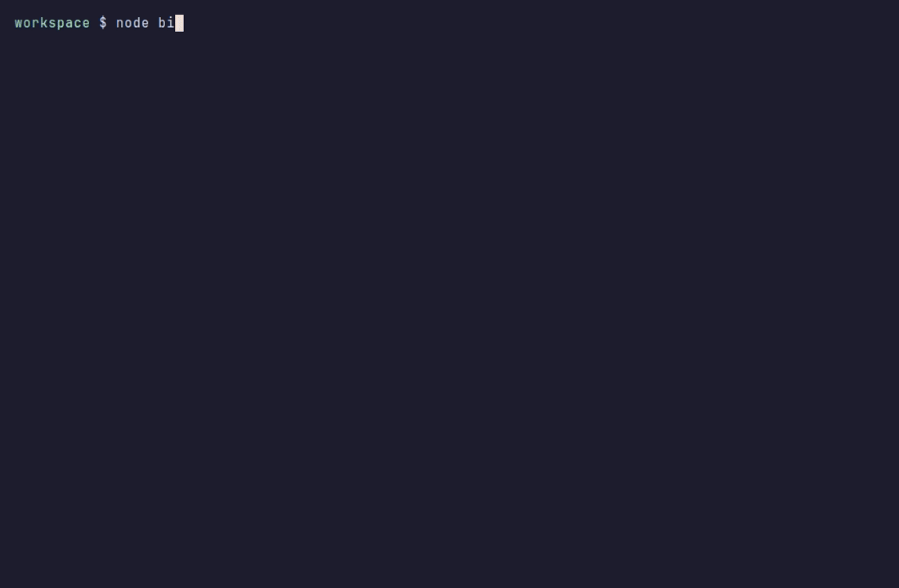

English | [Türkçe](README.tr.md)

[](https://github.com/bymustfa/vsx-diff/actions/workflows/ci.yml)
[](https://scorecard.dev/viewer/?uri=github.com/bymustfa/vsx-diff)
[](https://www.npmjs.com/package/vsx-diff)



# vsx-diff

`vsx-diff` shows what actually changed between two versions of a VS Code, Cursor, or VSCodium extension, scores the risky parts, and lets you pin a known version, roll back, or refuse an update until it is old enough.

Extensions run with your user account. They can read the workspace, spawn processes, and update themselves in the background. A diff you can read before that update lands is the practical control most editors still do not give you.

## Why this matters

Two public incidents from October 2026 are the reason this tool exists.

**A tampered Claude Code extension on the Cursor marketplace.** On 29 October 2026, [Phorion](https://phorion.io/blog/offical-claude-code-vsx-compromise/) reported that versions `2.1.312` and `2.1.313` of the Claude Code extension bundle on the Cursor marketplace contained a persistent SSH backdoor. Cursor's [security notice](https://cursor.com/blog/claude-code-extension-security-notice) says those builds were not developed by Anthropic, were offered for macOS and Windows between about 2:27 a.m. and 1:35 p.m. PT that day, and tried to plant an SSH key, open a reverse tunnel, and keep it alive after the editor closed. On the [Hacker News thread](https://news.ycombinator.com/item?id=50300683), Anthropic's Felix Rieseberg and Dworken said this was not a compromise of Anthropic's systems: the tampered package was published through Cursor's marketplace, and Open VSX and the Visual Studio Marketplace were not the source. Version `2.1.313` was never published on Open VSX. The Phorion URL says "vsx"; the corrected write-up and Anthropic's comments scope the incident to Cursor's marketplace. The useful lesson is older than the argument about which registry served the bytes: an extension update can run code the publisher you trust did not ship, and uninstalling the extension does not remove persistence the payload already dropped.

**A Codex extension update that broke the UI.** [openai/codex#56655](https://github.com/openai/codex/issues/56655) reports that after the VS Code extension moved to `26.51021.22027` (logs also record `26.1021.22027`), Codex failed to start its interface (`renderer_ready_timeout`, "Codex could not start"). People got it back by rolling the extension back to `26.51007.21434` or `26.1007.21434`. A bad update does not have to be malware to ruin a workday. You still want the previous VSIX and a way to stay there.

`vsx-diff` is the pre-flight check for both cases: read the delta, keep the version you meant to run, and let a new release sit until it is old enough.

## How is this different?

[**trailofbits/vsix-audit**](https://github.com/trailofbits/vsix-audit) is a security scanner for one extension package. You point it at a `.vsix` or a marketplace id and it runs detection modules (manifest and runtime behavior, indicators of compromise, AST patterns, obfuscation, telemetry, and optional YARA rules) plus a threat-intel zoo. It answers "does this single package look malicious?" It does not diff two releases, pin a known-good version, roll an editor back, or enforce a waiting period.

[**valmet083/ovsx-extension-cooldown**](https://github.com/valmet083/ovsx-extension-cooldown) is an editor extension (`valmet083.extension-cooldown`). It asks Open VSX how old the newest release is and sorts updates into "ready" and "in cooldown" (default 3 days), with per-extension overrides, skip, and install actions. It enforces a waiting period inside the editor. It does not diff package contents or score risk, and it queries Open VSX only.

`vsx-diff` is the version-to-version diff, the risk summary, and pin / rollback / cooldown in one CLI. It works offline on two local `.vsix` files, and `--fail-on` gives CI a non-zero exit when a diff is too risky.

## Install

Requires Node.js 20+. The package is on npm: [vsx-diff](https://www.npmjs.com/package/vsx-diff), published with provenance.

Run it without installing:

```bash
npx vsx-diff --help
```

Or install it globally:

```bash
npm i -g vsx-diff
vsx-diff --help
```

### From source

From a git checkout, build first, then run the built CLI:

```bash
npm install
npm run build
node bin/vsx-diff.js --help
```

## Quickstart

Compare the installed copy of an extension with the latest Open VSX release (Marketplace is the fallback):

```bash
vsx-diff EditorConfig.EditorConfig
```

Compare two published versions:

```bash
vsx-diff EditorConfig.EditorConfig --from 0.16.6 --to 0.18.2
```

Compare two files you already have, with no network:

```bash
vsx-diff compare demo/fixtures/goodpub.hello-1.0.0.vsix demo/fixtures/evilpub.hello-1.1.0.vsix
```

Fail a CI job when the risk is high:

```bash
vsx-diff compare old.vsix new.vsix --fail-on high
```

Hold every update for a week, then see what that does to installed extensions:

```bash
vsx-diff cooldown 7
vsx-diff check
```

## Example terminal output

Offline fixture (`npm run demo`). The address `203.0.113.10` is [RFC 5737](https://www.rfc-editor.org/rfc/rfc5737) documentation space, not a live host.

```text
vsx-diff  evilpub.hello
1.0.0 (file)  →  1.1.0 (file)
demo/fixtures/goodpub.hello-1.0.0.vsix  →  demo/fixtures/evilpub.hello-1.1.0.vsix

Risk  HIGH  score 583
  +100  high    Publisher changed from goodpub to evilpub. A publisher change means a different account now ships this extension.
  + 80  high    activationEvents added "*", so the extension activates on every event.
  + 70  high    npm lifecycle script added: postinstall (node payload.js). Install scripts run when the package is installed.
  + 60  high    native.node: New native binary (.node). Native code runs outside the JavaScript sandbox.
  + 55  high    extension.js: New eval( call. The extension can execute a string as code.
  + 55  high    extension.js: New Function constructor. The extension can compile a string into code.
  + 35  medium  payload.bin: Shannon entropy 7.80 bits/byte on 1024 sampled bytes (threshold 7.5). Random-looking content is unusual outside images, fonts, archives, and wasm.
  + 30  medium  untrustedWorkspaces.supported is now true, so the extension may run in untrusted workspaces.
  + 30  medium  extension.js: New child_process reference. The extension can spawn local processes.
  + 25  medium  extension.js: New raw IP: 203.0.113.10. Hard-coded addresses are a common callback pattern.
  + 20  medium  extensionDependencies added evilpub.helper. Installing this update pulls in more extensions.
  + 10  low     dependencies added: evil-lib@9.9.9
  +  8  low     extension.js: New URL: http://203.0.113.10/stage.
  +  5  low     contributes changed: commands 1 → 2; commands added evilpub.collect.
```

The same command with color is recorded in `demo/fixture-example.cast` (asciinema v2). The plain transcript is `demo/fixture-example.txt`.

## Commands

```text
vsx-diff [extensionId] [options]
vsx-diff compare <old.vsix> <new.vsix> [options]
vsx-diff pin <publisher.name@version> [--dry-run]
vsx-diff unpin <publisher.name>
vsx-diff rollback <publisher.name> [--to <version>] [--dry-run]
vsx-diff cooldown <days>
vsx-diff policy show
vsx-diff policy set --min-age <duration>
vsx-diff check [--json] [--fail-on allowed|held]
```

`vsx-diff <publisher.name>` downloads both sides from Open VSX, then the VS Code Marketplace if Open VSX does not have the extension. `--from` defaults to the installed version when one is found, otherwise the previous published release. `--to` defaults to the latest release. Pre-releases are skipped unless you pass `--pre-release`.

| Flag | Meaning |
| --- | --- |
| `--from`, `--to` | Versions to compare. |
| `--left`, `--right` | Local `.vsix` files. Same as `compare`. |
| `--json`, `--markdown` | Machine-readable or PR-comment output. JSON is the only thing written to stdout. |
| `--fail-on low\|medium\|high` | Exit 1 when the diff risk is at least that level. |
| `--source auto\|openvsx\|marketplace` | Which registry to ask. `auto` tries Open VSX first. |
| `--extensions-dir <path>` | Extra directory of installed extensions. Repeatable. |
| `--no-default-extension-dirs` | Do not scan `~/.vscode/extensions`, `~/.cursor/extensions`, or `~/.vscode-oss/extensions`. |
| `--config <path>` | Policy file. Default `$VSX_DIFF_CONFIG` or `~/.config/vsx-diff/config.json` (`XDG_CONFIG_HOME` is honored). |
| `--cache-dir <path>` | VSIX cache. Default `$VSX_DIFF_CACHE` or `~/.cache/vsx-diff`. |
| `--refresh` | Redownload even when the cache has the VSIX. |
| `--editor auto\|code\|cursor\|codium` | Which CLI `pin` and `rollback` invoke. |
| `--timeout <ms>` | HTTP timeout. Default 60000. |
| `--dry-run` | On `pin`, `rollback`, `cooldown`, and `policy set`: print the action and do not write policy or call the editor. |
| `--force-color`, `--no-color` | Color control. `NO_COLOR` and `FORCE_COLOR` are also honored. Piped output is plain unless `--force-color` is set. |

### What the default version means

Installed extensions are read from the unpacked directory (`package.json` inside `~/.vscode/extensions`, `~/.cursor/extensions`, or `~/.vscode-oss/extensions`). That tree is the "from" side when its version matches `--from` or when you did not pass `--from`. The "to" side is the downloaded VSIX. If nothing is installed and you did not pass `--from`, the previous registry release is the base.

### Policy

`cooldown 7` is the short form of `policy set --min-age 7d`. A bare number is days. `48h`, `1w`, and `30m` also work. `cooldown 0` clears the rule.

`pin publisher.name@1.2.3` records the version. When `code`, `cursor`, or `codium` is on `PATH`, it downloads that VSIX and runs:

```text
code --install-extension <cache>/<id>/<version>-<source>.vsix --force
```

`rollback` picks the newest registry version older than what is installed (or `--to`), pins it, and installs it the same way.

If none of those CLIs exist, `pin`, `rollback`, and `cooldown` still save the policy (unless you passed `--dry-run`) and print the editor command they would have run, plus the setting that stops the editor from bypassing the cooldown:

```json
{ "extensions.autoUpdate": false }
```

`vsx-diff` does not edit editor settings itself. `check` is what enforces the policy: it lists installed extensions, the registry's latest version, and whether that update is `allowed`, `held` (pin and/or cooldown), `up to date`, `unknown`, or `error`.

### Exit codes

| Code | When |
| --- | --- |
| 0 | The command finished. For a diff, the risk is below `--fail-on` (or `--fail-on` was omitted). |
| 1 | Diff risk is at least `--fail-on`, or `check --fail-on allowed\|held` saw a row in that state. |
| 2 | Usage error, unknown extension, or an install invoked through the editor CLI failed. |

### Real Open VSX example

```bash
vsx-diff EditorConfig.EditorConfig --from 0.16.6 --to 0.18.2
```

That pair is `EditorConfig.EditorConfig` 0.16.6 (published 2021-08-23) against 0.18.2 (published 2026-04-09). The report is medium, score 59: `untrustedWorkspaces.supported` becomes true, `engines.vscode` moves from `^1.51.1` to `^1.100.0`, the `editorconfig` dependency moves to `^3.0.2`, and the package gains a bundled `node_modules` tree (98 files added, 20 modified, 30 removed). Full plain output is `demo/real-example.txt`, JSON is `demo/real-example.json`, and a colored asciinema recording is `demo/real-example.cast`.

```text
vsx-diff  EditorConfig.EditorConfig
0.16.6 (openvsx)  →  0.18.2 (openvsx)
published 2021-08-23T03:21:59.146068Z  →  2026-04-09T04:09:42.629870Z

Risk  MEDIUM  score 59
  + 30  medium  untrustedWorkspaces.supported is now true, so the extension may run in untrusted workspaces.
  +  5  low     contributes changed: contribution contents changed.
  +  2  low     dependencies bumped: editorconfig@^3.0.2
```

## JSON schema summary

`--json` prints one object. `schemaVersion` is `1`.

Diff report:

```text
{
  schemaVersion: 1,
  extensionId: string,
  from, to: { version, source, path, publishedAt },
  risk: {
    level: "low" | "medium" | "high",
    score: number,
    reasons: string[],
    factors: { points, severity, reason }[]
  },
  manifest: { field, from, to, note }[],
  scripts: { name, kind: "added"|"removed"|"changed", from, to }[],
  dependencies: {
    section: "dependencies"|"devDependencies"|"optionalDependencies",
    name, kind: "added"|"removed"|"bumped", from, to
  }[],
  files: {
    added, removed, modified, unchanged: number,
    changes: { path, kind, sizeBefore, sizeAfter, delta, sha256Before, sha256After }[]
  },
  suspicious: {
    path, category: "minified"|"high-entropy"|"native-binary"|"indicator",
    severity, indicator, points, detail
  }[],
  notes: string[]
}
```

`check --json` prints `{ schemaVersion, generatedAt, minAge, extensionsDirs, extensions: UpdateRow[] }` where each row has `id`, `installed`, `latest`, `publishedAt`, `source`, `status`, `reasons`, and `pin`.

### Policy file

`~/.config/vsx-diff/config.json`:

```json
{
  "minAge": "7d",
  "pins": { "editorconfig.editorconfig": "0.17.4" },
  "extensionsDirs": [],
  "editor": "auto",
  "cacheDir": null
}
```

`minAge` is a duration or `null`. Pin keys are lowercase extension ids.

### How the score works

Each finding has points and a severity. The level is the highest severity. Many lows are capped at 30 points so a dependency refresh cannot pretend to be an incident. The level becomes medium when any medium finding exists or the score reaches 25, and high when any high finding exists or medium findings add up to 90 or more.

| Finding | Severity |
| --- | --- |
| Publisher change | high, +100 |
| `activationEvents` gains `*` | high, +80 |
| New or changed `preinstall` / `install` / `postinstall` (and uninstall scripts) | high, +70 |
| New `.node`, `.exe`, `.dll`, `.so`, `.dylib` | high, +60 |
| New `eval(` or `new Function` in the extension's own JS/TS | high, +55 |
| New `onStartupFinished` or `onStartup` | medium, +40 |
| New high-entropy blob (≥ 7.5 bits/byte, ≥ 512 bytes, not a known media/wasm/archive type) | medium, +35 |
| `prepare` and other pack/publish lifecycle scripts | medium, +30 |
| Script that newly looks minified (entropy ≥ 5.2 and average line length ≥ 180) | medium, +30 |
| `untrustedWorkspaces.supported` becomes true | medium, +30 |
| New `child_process` reference, new public IPv4, `main`/`browser` change, new `extensionDependencies` / `extensionPack` | medium |
| New activation events, dependency adds and bumps, `contributes` edits | low, and the low points are capped |

URL and IP matches inside an already-minified bundle are ignored. Nothing under `node_modules/` is treated as the extension's own behavior; new native binaries anywhere are still reported. Private, loopback, and link-local addresses are not reported.

## Demo

```bash
npm run demo
```

That builds the CLI and compares the committed malicious-update fixtures with no network. `npm run generate:fixtures` rewrites `demo/fixtures/*.vsix` from `src/fixture.ts`.

| File | What it is |
| --- | --- |
| `demo/fixtures/goodpub.hello-1.0.0.vsix` | Clean fixture |
| `demo/fixtures/evilpub.hello-1.1.0.vsix` | Publisher change, `activationEvents: ["*"]`, `postinstall`, high-entropy blob, native addon, `eval` / `Function` / `child_process` |
| `demo/fixture-example.txt` | Plain offline demo |
| `demo/fixture-example.cast` | Colored offline demo (asciinema) |
| `demo/real-example.txt` | `EditorConfig.EditorConfig` 0.16.6 → 0.18.2 |
| `demo/real-example.json` | Same diff as JSON |
| `demo/real-example.cast` | Colored real diff (asciinema) |

## Development

```bash
npm install
npm test
npm run lint
npm run typecheck
npm run build
```

GitHub Actions runs lint, typecheck, test, build, and the offline demo on Ubuntu with Node.js 20 and 22. The status checks are `ci (20)` and `ci (22)`.

## Roadmap

- A Cursor marketplace source. The October 2026 Claude Code incident was served from Cursor's marketplace, which this CLI does not query.
- Signature checks when a registry signs the VSIX, instead of trusting the download URL alone.
- An AST pass so minified bundles can be judged by behavior, not line length.
- SARIF output, publisher allow and deny lists, and path ignores.
- An editor hook that runs this diff before auto-update, and a way to set `extensions.autoUpdate` without handing you a JSON snippet.

## Limitations

The score is a heuristic, not a malware verdict. A clean diff can still be malicious, and a minified legitimate bundle can look loud. `check` uses registry metadata (version and publish time) and does not download every VSIX, so it will not tell you the risk of an update until you diff it. Publish times come from the registry. Open VSX is tried first; the public VS Code Marketplace gallery API is the fallback. Platform-specific builds prefer a universal package when both exist. `pin` and `rollback` can install through `code`, `cursor`, or `codium`; without one of those binaries they save the policy and print the command. They do not turn off the editor's own auto-update.

## License

[MIT](LICENSE)
