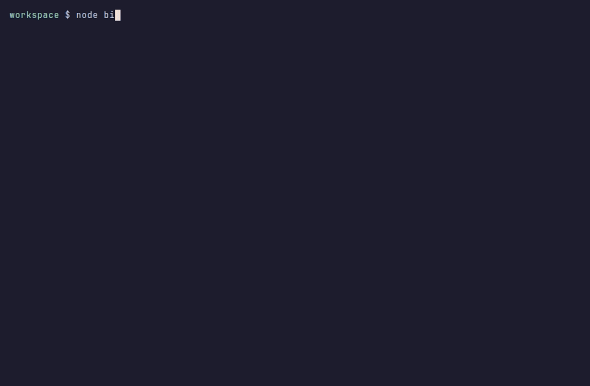

[English](README.md) | Türkçe

[](https://github.com/bymustfa/vsx-diff/actions/workflows/ci.yml)
[](https://scorecard.dev/viewer/?uri=github.com/bymustfa/vsx-diff)
[](https://www.npmjs.com/package/vsx-diff)



# vsx-diff

`vsx-diff`, bir VS Code, Cursor veya VSCodium eklentisinin iki sürümü arasında gerçekten neyin değiştiğini gösterir. Riskli yerleri puanlar; bildiğiniz bir sürümü sabitlemenize, geri almanıza ya da yeni sürüm yeterince eskimeden onu kabul etmemenize yarar.

Eklentiler sizin kullanıcınızla çalışır. Çalışma alanını okuyabilir, süreç başlatabilir ve arka planda kendi kendilerini güncelleyebilir. Güncelleme inmeden önce okuyabildiğiniz bir fark, çoğu editörün hâlâ vermediği pratik kontrol budur.

## Neden önemli

Bu araç, Ekim 2026’daki iki kamuoyuna açık olay yüzünden var.

**Cursor marketindeki kurcalanmış Claude Code eklentisi.** 29 Ekim 2026’da [Phorion](https://phorion.io/blog/offical-claude-code-vsx-compromise/), Cursor marketindeki Claude Code eklenti paketinin `2.1.312` ve `2.1.313` sürümlerinde kalıcı bir SSH arka kapısı bulunduğunu yazdı. Cursor’un [güvenlik duyurusu](https://cursor.com/blog/claude-code-extension-security-notice), bu derlemelerin Anthropic tarafından geliştirilmediğini, o gün yaklaşık 02:27–13:35 PT arasında macOS ve Windows için sunulduğunu ve bir SSH anahtarı yerleştirmeye, ters tünel açmaya, editör kapandıktan sonra da bunu ayakta tutmaya çalıştığını söylüyor. [Hacker News başlığında](https://news.ycombinator.com/item?id=50300683) Anthropic’ten Felix Rieseberg ve Dworken, bunun Anthropic sistemlerinin ele geçirilmesi olmadığını belirtti: kurcalanmış paket Cursor’un marketi üzerinden yayımlanmıştı; kaynak Open VSX ya da Visual Studio Marketplace değildi. `2.1.313` Open VSX’te hiç yayımlanmadı. Phorion adresinde “vsx” geçiyor; düzeltilmiş yazı ve Anthropic’in yorumları olayı Cursor marketiyle sınırlıyor. Asıl ders, baytların hangi kayıttan geldiği tartışmasından daha eski: bir eklenti güncellemesi, güvendiğiniz yayımcının göndermediği kodu çalıştırabilir ve eklentiyi kaldırmak, yükün çoktan bıraktığı kalıcılığı silmez.

**Arayüzü bozan bir Codex eklenti güncellemesi.** [openai/codex#56655](https://github.com/openai/codex/issues/56655), VS Code eklentisi `26.51021.22027` sürümüne geçince (günlüklerde `26.1021.22027` de görünüyor) Codex’in arayüzünün açılmadığını bildiriyor (`renderer_ready_timeout`, “Codex could not start”). İnsanlar eklentiyi `26.51007.21434` ya da `26.1007.21434` sürümüne geri alarak işi düzeltti. Kötü bir güncellemenin iş gününü mahvetmesi için kötücül yazılım olması şart değil. Yine de önceki VSIX’e ve orada kalmanın bir yoluna ihtiyaç var.

`vsx-diff` iki durum için de kalkış öncesi kontrol: farkı okuyun, çalıştırmak istediğiniz sürümde kalın, yeni sürüm yeterince eskimeden onu bekletin.

## Bu araç diğerlerinden nasıl ayrılıyor?

[**trailofbits/vsix-audit**](https://github.com/trailofbits/vsix-audit) tek bir eklenti paketini tarayan bir güvenlik tarayıcısı. Bir `.vsix` dosyasına ya da market kimliğine tutuyorsunuz; bildirim modülleri (manifest ve çalışma zamanı davranışı, uzlaşma göstergeleri, AST kalıpları, gizleme, telemetri ve isteğe bağlı YARA kuralları) ile bir tehdit istihbaratı koleksiyonu çalışıyor. Soru şu: “bu tek paket kötücül mü görünüyor?” İki sürümü karşılaştırmıyor, bilinen iyi bir sürümü sabitlemiyor, editörü geri almıyor ve bekleme süresi uygulamıyor.

[**valmet083/ovsx-extension-cooldown**](https://github.com/valmet083/ovsx-extension-cooldown) bir editör eklentisi (`valmet083.extension-cooldown`). Open VSX’e en yeni sürümün kaç günlük olduğunu soruyor ve güncellemeleri “hazır” ile “beklemede” diye ayırıyor (varsayılan 3 gün). Eklenti bazında istisna, atlama ve kurma eylemleri var. Bekleme süresini editörün içinde uyguluyor. Paket içeriğini karşılaştırmıyor, risk puanlamıyor ve yalnızca Open VSX’e bakıyor.

`vsx-diff` sürümden sürüme farkı, risk özetini ve sabitleme / geri alma / bekleme süresini tek bir komut satırı aracında topluyor. İki yerel `.vsix` dosyasıyla çevrimdışı çalışıyor. `--fail-on`, fark fazla riskliyse CI’ya sıfırdan farklı bir çıkış veriyor.

## Kurulum

Node.js 20 veya daha yenisi gerekir. Paket npm'de: [vsx-diff](https://www.npmjs.com/package/vsx-diff). Provenance ile yayımlanır.

Kurmadan çalıştırmak için:

```bash
npx vsx-diff --help
```

Ya da genel olarak kurun:

```bash
npm i -g vsx-diff
vsx-diff --help
```

### Kaynaktan

Bir git kopyasında önce derleyin, sonra derlenmiş CLI'ı çalıştırın:

```bash
npm install
npm run build
node bin/vsx-diff.js --help
```

## Hızlı başlangıç

Yüklü eklentiyi Open VSX’teki en son sürümle karşılaştırın (yoksa Marketplace’e düşer):

```bash
vsx-diff EditorConfig.EditorConfig
```

Yayımlanmış iki sürümü karşılaştırın:

```bash
vsx-diff EditorConfig.EditorConfig --from 0.16.6 --to 0.18.2
```

Elinizdeki iki dosyayı, ağa çıkmadan:

```bash
vsx-diff compare demo/fixtures/goodpub.hello-1.0.0.vsix demo/fixtures/evilpub.hello-1.1.0.vsix
```

Risk yüksekse CI işini düşürün:

```bash
vsx-diff compare old.vsix new.vsix --fail-on high
```

Her güncellemeyi bir hafta bekletin, sonra bunun yüklü eklentilere ne dediğine bakın:

```bash
vsx-diff cooldown 7
vsx-diff check
```

## Örnek uçbirim çıktısı

Çevrimdışı örnek (`npm run demo`). `203.0.113.10` adresi canlı bir konak değil, [RFC 5737](https://www.rfc-editor.org/rfc/rfc5737) belgeleme alanıdır.

```text
vsx-diff  evilpub.hello
1.0.0 (file)  →  1.1.0 (file)
demo/fixtures/goodpub.hello-1.0.0.vsix  →  demo/fixtures/evilpub.hello-1.1.0.vsix

Risk  HIGH  score 583
  +100  high    Publisher changed from goodpub to evilpub. A publisher change means a different account now ships this extension.
  + 80  high    activationEvents added "*", so the extension activates on every event.
  + 70  high    npm lifecycle script added: postinstall (node payload.js). Install scripts run when the package is installed.
  + 60  high    native.node: New native binary (.node). Native code runs outside the JavaScript sandbox.
  + 55  high    extension.js: New eval( call. The extension can execute a string as code.
  + 55  high    extension.js: New Function constructor. The extension can compile a string into code.
  + 35  medium  payload.bin: Shannon entropy 7.80 bits/byte on 1024 sampled bytes (threshold 7.5). Random-looking content is unusual outside images, fonts, archives, and wasm.
  + 30  medium  untrustedWorkspaces.supported is now true, so the extension may run in untrusted workspaces.
  + 30  medium  extension.js: New child_process reference. The extension can spawn local processes.
  + 25  medium  extension.js: New raw IP: 203.0.113.10. Hard-coded addresses are a common callback pattern.
  + 20  medium  extensionDependencies added evilpub.helper. Installing this update pulls in more extensions.
  + 10  low     dependencies added: evil-lib@9.9.9
  +  8  low     extension.js: New URL: http://203.0.113.10/stage.
  +  5  low     contributes changed: commands 1 → 2; commands added evilpub.collect.
```

Aynı komutun renkli kaydı `demo/fixture-example.cast` (asciinema v2). Düz metin dökümü `demo/fixture-example.txt`.

## Komutlar

```text
vsx-diff [extensionId] [options]
vsx-diff compare <old.vsix> <new.vsix> [options]
vsx-diff pin <publisher.name@version> [--dry-run]
vsx-diff unpin <publisher.name>
vsx-diff rollback <publisher.name> [--to <version>] [--dry-run]
vsx-diff cooldown <days>
vsx-diff policy show
vsx-diff policy set --min-age <duration>
vsx-diff check [--json] [--fail-on allowed|held]
```

`vsx-diff <publisher.name>` iki tarafı da önce Open VSX’ten indirir. Eklenti orada yoksa VS Code Marketplace’e bakar. `--from`, yüklü bir sürüm bulunursa odur; yoksa bir önceki yayımlanmış sürümdür. `--to` en son sürümdür. `--pre-release` vermezseniz ön sürümler atlanır.

| Bayrak | Anlamı |
| --- | --- |
| `--from`, `--to` | Karşılaştırılacak sürümler. |
| `--left`, `--right` | Yerel `.vsix` dosyaları. `compare` ile aynı iş. |
| `--json`, `--markdown` | Makinece okunur çıktı ya da PR yorumu. JSON, stdout’a yazılan tek şeydir. |
| `--fail-on low\|medium\|high` | Farkın riski en az bu düzeydeyse 1 ile çıkar. |
| `--source auto\|openvsx\|marketplace` | Hangi kayıt sorulacak. `auto` önce Open VSX’e bakar. |
| `--extensions-dir <path>` | Yüklü eklentiler için ek dizin. Tekrarlanabilir. |
| `--no-default-extension-dirs` | `~/.vscode/extensions`, `~/.cursor/extensions` ve `~/.vscode-oss/extensions` taranmasın. |
| `--config <path>` | İlke dosyası. Varsayılan `$VSX_DIFF_CONFIG` ya da `~/.config/vsx-diff/config.json` (`XDG_CONFIG_HOME` dikkate alınır). |
| `--cache-dir <path>` | VSIX önbelleği. Varsayılan `$VSX_DIFF_CACHE` ya da `~/.cache/vsx-diff`. |
| `--refresh` | Önbellekte VSIX olsa bile yeniden indir. |
| `--editor auto\|code\|cursor\|codium` | `pin` ve `rollback` hangi CLI’yi çağıracak. |
| `--timeout <ms>` | HTTP zaman aşımı. Varsayılan 60000. |
| `--dry-run` | `pin`, `rollback`, `cooldown` ve `policy set` için: eylemi yazdır, ilkeyi kaydetme, editörü çağırma. |
| `--force-color`, `--no-color` | Renk. `NO_COLOR` ve `FORCE_COLOR` da geçerlidir. Boruya aktarılan çıktı, `--force-color` yoksa düzdür. |

### Varsayılan sürüm ne demek

Yüklü eklentiler açılmış dizinden okunur (`~/.vscode/extensions`, `~/.cursor/extensions` veya `~/.vscode-oss/extensions` içindeki `package.json`). Bu ağaç, sürümü `--from` ile uyuşuyorsa ya da `--from` vermediyseniz “eski” taraftır. “Yeni” taraf indirilen VSIX’tir. Hiçbir şey yüklü değilse ve `--from` vermediyseniz taban, kayıttaki bir önceki sürümdür.

### İlke

`cooldown 7`, `policy set --min-age 7d` komutunun kısasıdır. Yalın bir sayı gün demektir. `48h`, `1w` ve `30m` de olur. `cooldown 0` kuralı siler.

`pin publisher.name@1.2.3` sürümü kaydeder. `PATH` üzerinde `code`, `cursor` veya `codium` varsa VSIX’i indirir ve şunu çalıştırır:

```text
code --install-extension <cache>/<id>/<version>-<source>.vsix --force
```

`rollback`, yüklü olandan daha eski olan en yeni kayıt sürümünü seçer (`--to` verdiyseniz onu), sabitler ve aynı yolla kurar.

Bu CLI’lerden hiçbiri yoksa `pin`, `rollback` ve `cooldown` ilkeyi yine kaydeder (`--dry-run` vermediyseniz) ve çalıştıracakları editör komutunu basar. Bir de editörün bekleme süresini baypas etmesini kesen ayarı yazar:

```json
{ "extensions.autoUpdate": false }
```

`vsx-diff` editör ayarlarını kendisi değiştirmez. İlkeyi uygulayan `check` komutudur: yüklü eklentileri, kayıttaki en son sürümü ve bu güncellemenin `allowed`, `held` (sabitleme ve/veya bekleme), `up to date`, `unknown` ya da `error` olduğunu listeler.

### Çıkış kodları

| Kod | Ne zaman |
| --- | --- |
| 0 | Komut bitti. Fark için risk, `--fail-on` eşiğinin altında (ya da `--fail-on` hiç verilmedi). |
| 1 | Fark riski en az `--fail-on`, ya da `check --fail-on allowed\|held` o durumda bir satır gördü. |
| 2 | Kullanım hatası, bilinmeyen eklenti ya da editör CLI’si üzerinden kurulum başarısız. |

### Gerçek bir Open VSX örneği

```bash
vsx-diff EditorConfig.EditorConfig --from 0.16.6 --to 0.18.2
```

Bu çift, `EditorConfig.EditorConfig` 0.16.6 (yayımlanma 2021-08-23) ile 0.18.2 (yayımlanma 2026-04-09). Rapor orta, puan 59: `untrustedWorkspaces.supported` true oluyor, `engines.vscode` `^1.51.1` iken `^1.100.0` oluyor, `editorconfig` bağımlılığı `^3.0.2` sürümüne çıkıyor ve paket paketlenmiş bir `node_modules` ağacı kazanıyor (98 dosya eklendi, 20 değişti, 30 silindi). Düz çıktının tamamı `demo/real-example.txt`, JSON `demo/real-example.json`, renkli asciinema kaydı `demo/real-example.cast`.

```text
vsx-diff  EditorConfig.EditorConfig
0.16.6 (openvsx)  →  0.18.2 (openvsx)
published 2021-08-23T03:21:59.146068Z  →  2026-04-09T04:09:42.629870Z

Risk  MEDIUM  score 59
  + 30  medium  untrustedWorkspaces.supported is now true, so the extension may run in untrusted workspaces.
  +  5  low     contributes changed: contribution contents changed.
  +  2  low     dependencies bumped: editorconfig@^3.0.2
```

## JSON şemasının özeti

`--json` tek bir nesne basar. `schemaVersion` `1` dir.

Fark raporu:

```text
{
  schemaVersion: 1,
  extensionId: string,
  from, to: { version, source, path, publishedAt },
  risk: {
    level: "low" | "medium" | "high",
    score: number,
    reasons: string[],
    factors: { points, severity, reason }[]
  },
  manifest: { field, from, to, note }[],
  scripts: { name, kind: "added"|"removed"|"changed", from, to }[],
  dependencies: {
    section: "dependencies"|"devDependencies"|"optionalDependencies",
    name, kind: "added"|"removed"|"bumped", from, to
  }[],
  files: {
    added, removed, modified, unchanged: number,
    changes: { path, kind, sizeBefore, sizeAfter, delta, sha256Before, sha256After }[]
  },
  suspicious: {
    path, category: "minified"|"high-entropy"|"native-binary"|"indicator",
    severity, indicator, points, detail
  }[],
  notes: string[]
}
```

`check --json` şunu basar: `{ schemaVersion, generatedAt, minAge, extensionsDirs, extensions: UpdateRow[] }`. Her satırda `id`, `installed`, `latest`, `publishedAt`, `source`, `status`, `reasons` ve `pin` vardır.

### İlke dosyası

`~/.config/vsx-diff/config.json`:

```json
{
  "minAge": "7d",
  "pins": { "editorconfig.editorconfig": "0.17.4" },
  "extensionsDirs": [],
  "editor": "auto",
  "cacheDir": null
}
```

`minAge` bir süre ya da `null` olur. Sabitleme anahtarları küçük harfli eklenti kimlikleridir.

### Puan nasıl işler

Her bulgunun puanı ve şiddeti vardır. Düzey, en yüksek şiddettir. Bir sürü düşük bulgu 30 puanda kesilir; böylece bir bağımlılık yenilemesi olay gibi görünmez. Herhangi bir orta bulgu varsa ya da puan 25’e ulaşırsa düzey orta olur. Herhangi bir yüksek bulgu varsa ya da orta bulgular 90 ve üzerine çıkarsa düzey yüksek olur.

| Bulgu | Şiddet |
| --- | --- |
| Yayımcı değişikliği | yüksek, +100 |
| `activationEvents` içine `*` eklenmesi | yüksek, +80 |
| Yeni ya da değişmiş `preinstall` / `install` / `postinstall` (ve kaldırma betikleri) | yüksek, +70 |
| Yeni `.node`, `.exe`, `.dll`, `.so`, `.dylib` | yüksek, +60 |
| Eklentinin kendi JS/TS dosyasında yeni `eval(` ya da `new Function` | yüksek, +55 |
| Yeni `onStartupFinished` ya da `onStartup` | orta, +40 |
| Yeni yüksek entropili yığın (≥ 7,5 bit/bayt, ≥ 512 bayt, bilinen bir ortam/wasm/arşiv türü değil) | orta, +35 |
| `prepare` ve diğer paketleme/yayımlama yaşam döngüsü betikleri | orta, +30 |
| Yeni küçültülmüş görünen betik (entropi ≥ 5,2 ve ortalama satır uzunluğu ≥ 180) | orta, +30 |
| `untrustedWorkspaces.supported` değerinin true olması | orta, +30 |
| Yeni `child_process` başvurusu, yeni genel IPv4, `main`/`browser` değişikliği, yeni `extensionDependencies` / `extensionPack` | orta |
| Yeni etkinleştirme olayları, bağımlılık ekleme ve yükseltmeleri, `contributes` düzenlemeleri | düşük; düşük puanlar tavanlıdır |

Zaten küçültülmüş bir paketin içindeki URL ve IP eşleşmeleri yok sayılır. `node_modules/` altındaki hiçbir şey eklentinin kendi davranışı sayılmaz; yeni yerel ikili dosyalar nerede olursa olsun bildirilir. Özel, geri döngü ve bağlantı yerel adresler bildirilmez.

## Demo

```bash
npm run demo
```

Bu, CLI’yi derler ve depoya konmuş kötücül güncelleme örneklerini ağ olmadan karşılaştırır. `npm run generate:fixtures`, `src/fixture.ts` dosyasından `demo/fixtures/*.vsix` arşivlerini yeniden yazar.

| Dosya | Ne olduğu |
| --- | --- |
| `demo/fixtures/goodpub.hello-1.0.0.vsix` | Temiz örnek |
| `demo/fixtures/evilpub.hello-1.1.0.vsix` | Yayımcı değişikliği, `activationEvents: ["*"]`, `postinstall`, yüksek entropili yığın, yerel eklenti, `eval` / `Function` / `child_process` |
| `demo/fixture-example.txt` | Düz çevrimdışı demo |
| `demo/fixture-example.cast` | Renkli çevrimdışı demo (asciinema) |
| `demo/real-example.txt` | `EditorConfig.EditorConfig` 0.16.6 → 0.18.2 |
| `demo/real-example.json` | Aynı farkın JSON’u |
| `demo/real-example.cast` | Renkli gerçek fark (asciinema) |

## Geliştirme

```bash
npm install
npm test
npm run lint
npm run typecheck
npm run build
```

GitHub Actions; lint, tür denetimi, test, derleme ve çevrimdışı demoyu Ubuntu üzerinde Node.js 20 ve 22 ile çalıştırır. Durum denetimleri `ci (20)` ve `ci (22)` adındadır.

## Yol haritası

- Cursor marketi kaynağı. Ekim 2026 Claude Code olayı Cursor’un marketinden sunuldu; bu CLI orayı sorgulamıyor.
- Bir kayıt VSIX’i imzaladığında imza denetimi; indirme adresine körü körüne güvenmek yerine.
- Küçültülmüş paketlerin satır uzunluğuna değil davranışa göre değerlendirilmesi için bir AST geçişi.
- SARIF çıktısı, yayımcı izin ve ret listeleri, yol yok saymaları.
- Otomatik güncellemeden önce bu farkı çalıştıran bir editör kancası ve `extensions.autoUpdate` ayarını size bir JSON parçası uzatmadan yapmanın yolu.

## Sınırlar

Puan bir sezgiseldir, kötücül yazılım kararı değildir. Temiz bir fark yine kötücül olabilir; meşru ama küçültülmüş bir paket de gürültülü görünebilir. `check` kayıt üstverisini (sürüm ve yayımlanma zamanı) kullanır ve her VSIX’i indirmez; bir güncellemenin riskini, onu karşılaştırana kadar söylemez. Yayımlanma zamanları kayıttan gelir. Önce Open VSX denenir; herkese açık VS Code Marketplace galeri API’si yedektir. Platforma özel derlemeler varsa evrensel paket yeğlenir. `pin` ve `rollback`, `code`, `cursor` veya `codium` üzerinden kurabilir; bu ikililerden hiçbiri yoksa ilkeyi kaydedip komutu basar. Editörün kendi otomatik güncellemesini kapatmazlar.

## Lisans

[MIT](LICENSE)
